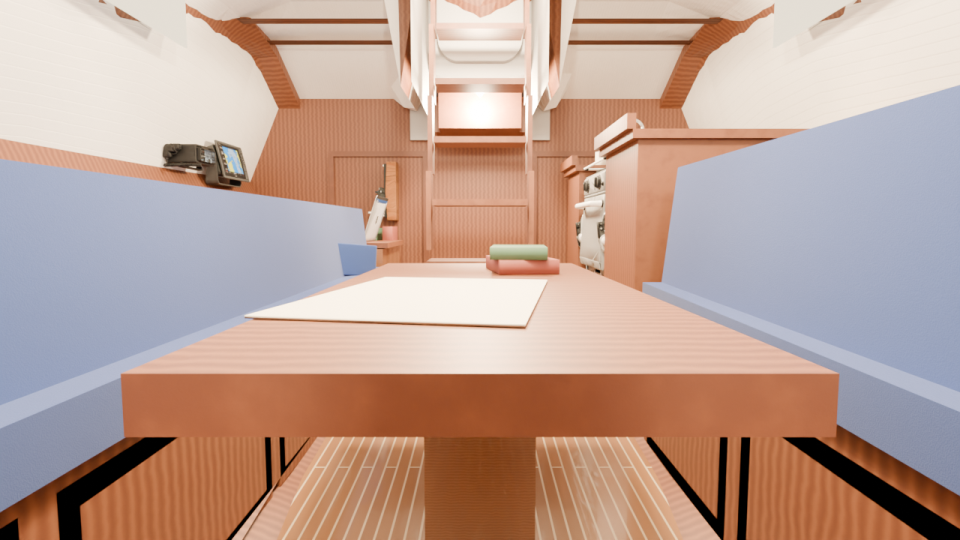
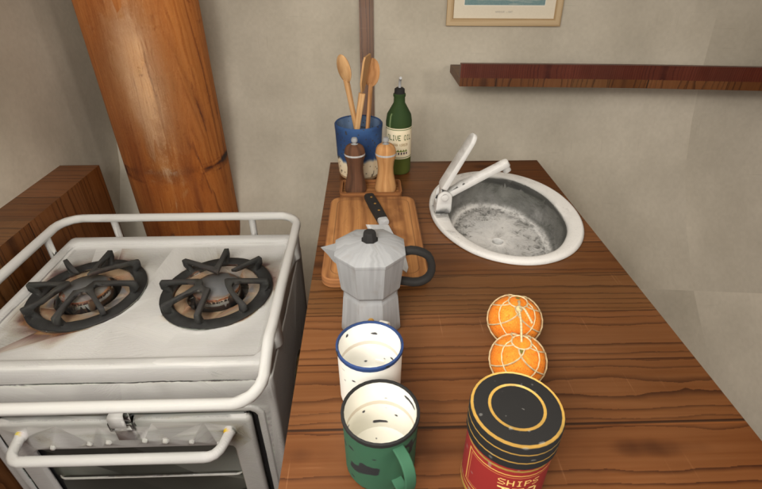
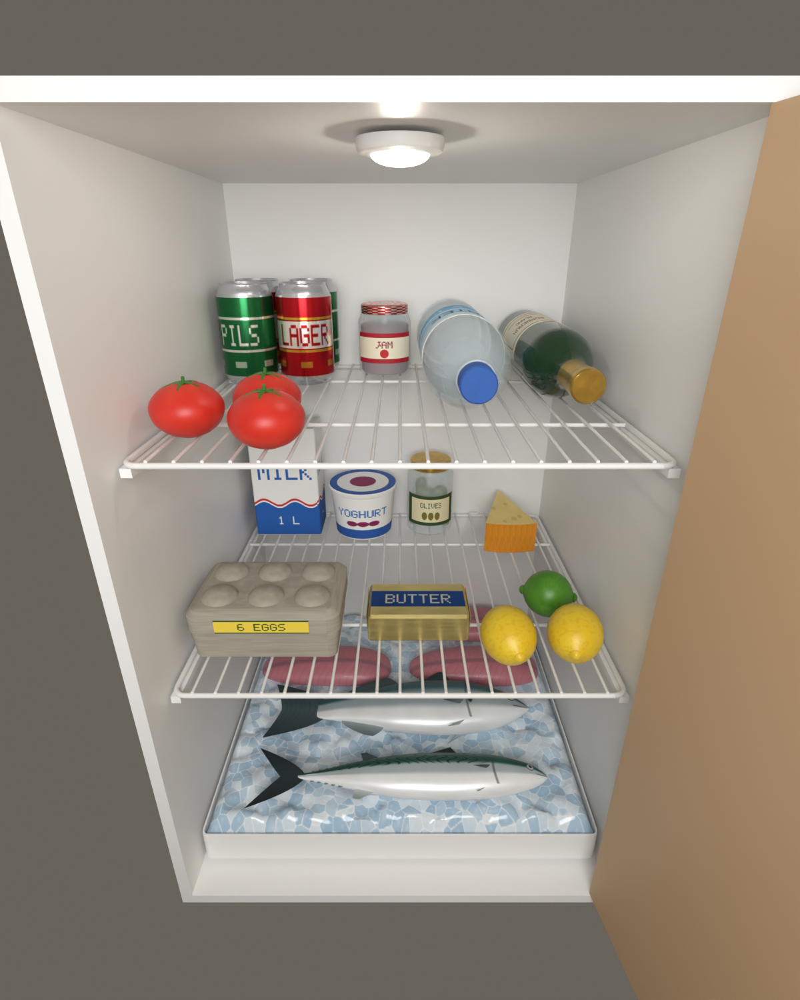
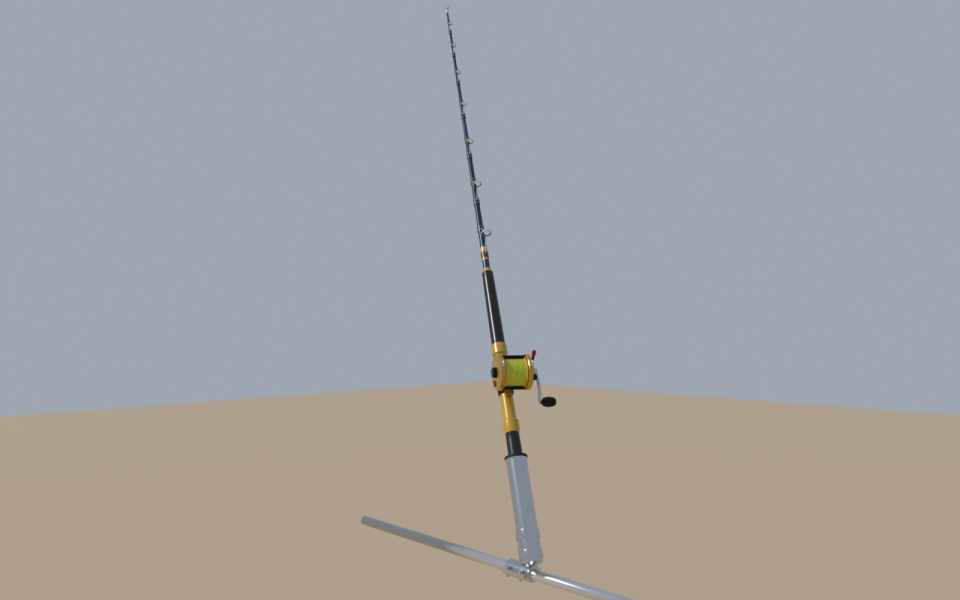
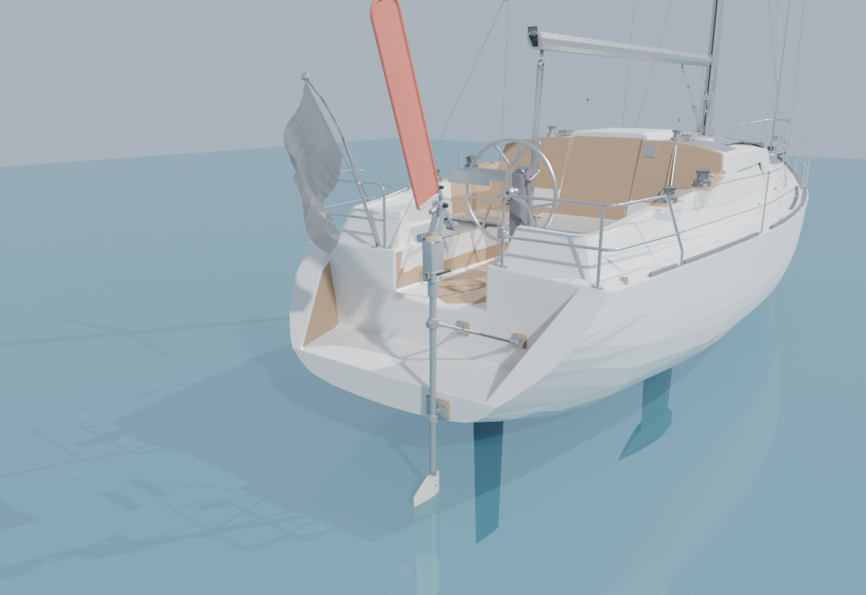
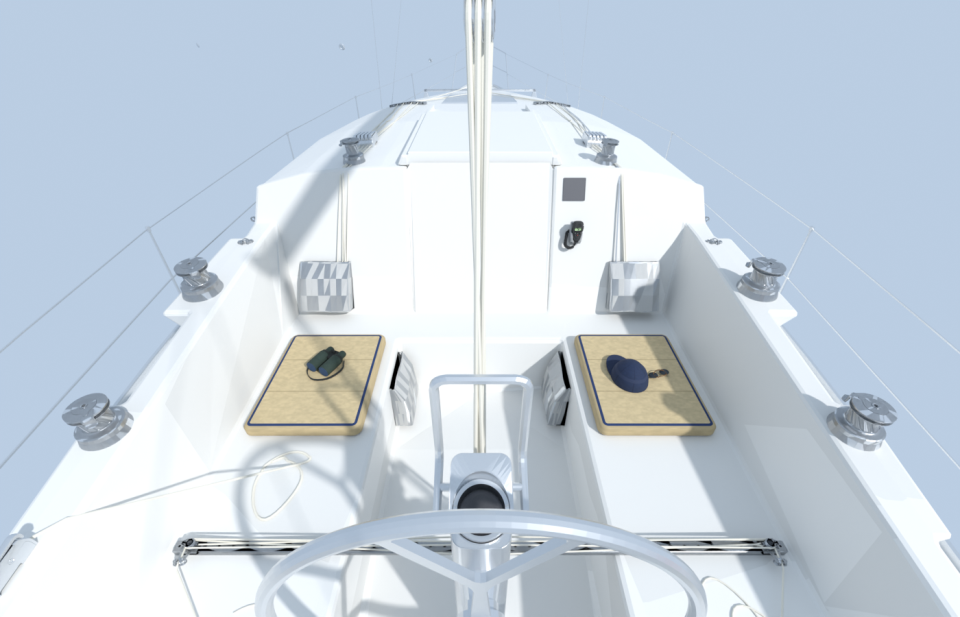
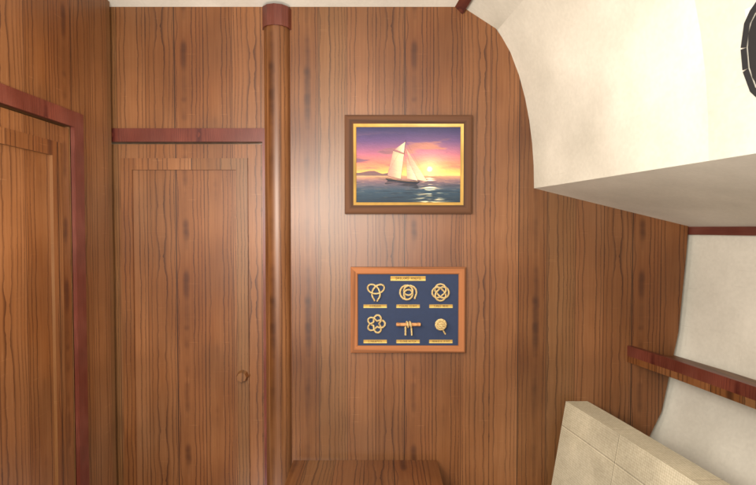
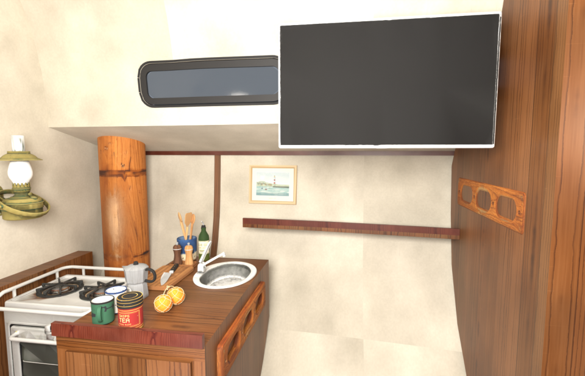
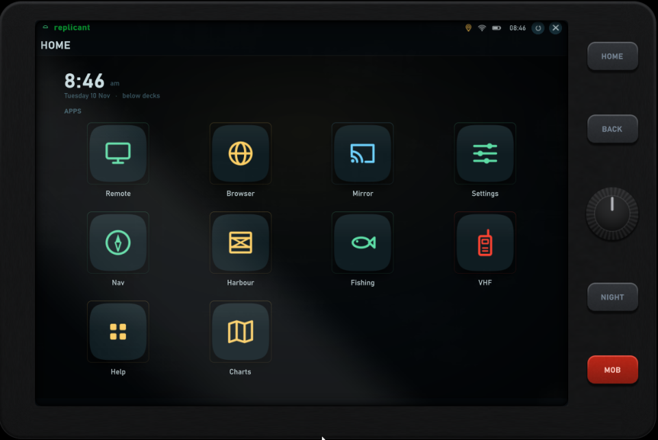

# Sailaway III – Walkable Interior Mod

A fan-made mod for **Sailaway III** that lets you go below decks into a furnished
cabin and live aboard: cook what you catch, read the instruments on a tablet,
let a wind-vane gear steer, and make the boat your own.

> Not affiliated with or endorsed by the makers of Sailaway. Use at your own risk.
> The interior is built for the **Sailaway Cruiser 38**; on other boats most of
> the mod (tablet, fishing, quests) still works, but there is no cabin to walk into.

**[Download the latest release →](../../releases/latest)**

## What it adds

- **A walkable, furnished interior** — saloon, galley, nav desk, heads and V-berth,
  with lamps, screens, pictures, books and the clutter of a boat that is lived on.
  Below decks the view rides with the boat, and spray and rain stay outside.
- **A tablet** you carry round the boat: chart and instruments, the VHF, harbour jobs,
  fishing, a web browser on the cabin screens, settings, and a Help app that explains
  everything.
- **Fishing with a real rod** on the stern: troll a lure, crank a fish in with the
  scroll wheel, land it flapping in the cockpit.
- **A working galley** — pan on the gimballed stove, gas flames, each side browning on
  its own, flip it, plate it, eat it. A stocked icebox keeps the catch.
- **A Hydrovane wind-vane self-steering gear** on the transom that actually steers by
  the wind (never better than the game's autopilot; locked in "All manual" races).
- **Your own pictures** in the cabin's frames, from your Pictures folder.
- **Sit** on the cockpit cushions and the settee, look through the binoculars, launch
  the drone from the coachroof.
- **Cargo, fishing and VHF-radio quests**, with optional spoken radio calls generated
  on your PC.
- **VR** (experimental, off unless you switch it on).

| | |
|---|---|
|  |  |
|  |  |
|  |  |
|  |  |

*Some pictures are renders of the mod's models rather than in-game screenshots.*

## Install

Download one of the installers from the [releases page](../../releases/latest):

| File | Size | What's in it |
|---|---|---|
| `…-Full-Setup.exe` | ~540 MB | Everything: the mod, spoken radio voices, the in-cabin web browser and the screen mirror. You choose which optional parts to install. |
| `…-Lite-Setup.exe` | ~90 MB | The mod only. Run the Full installer later to add the extras. |
| `…-Lite.zip` | ~90 MB | The mod only, for installing by hand: unzip and run `Install.cmd`. |

1. Close the game.
2. Run the installer. It finds Sailaway III through Steam, installs
   [MelonLoader](https://github.com/LavaGang/MelonLoader) 0.7.3 if you don't have it,
   copies the mod, and asks you to start the game once so MelonLoader can finish
   setting up.
3. In the game, middle-click with nothing in front of you to bring up the tablet,
   and open **Help**.

Windows may warn that the installer is from an unknown publisher (it isn't
code-signed). Check the file against `SHA256SUMS.txt` on the release page if you
want to be sure it is the file published here.

**Updating:** install the new version over the old one. Your cabin layout,
bookmarks, TV channels, pictures, progress and settings are kept; anything new in
the update appears in its default place.

**Uninstalling:** double-click **Uninstall Sailaway Interior Mod.cmd** in the game
folder. It keeps your own files for a later reinstall unless you run it with
`-Purge`. MelonLoader stays (Steam's *Verify integrity of game files* removes it).

## What goes online

The mod runs on your PC. The exceptions:

- **Extra building footprints** (optional) downloads map tiles from Microsoft while you sail.
- **The in-cabin web browser** (optional) loads the pages you open.
- **The Hydrovane in races:** the first time you engage it in a race, the mod posts
  one line in that race's chat saying you are sailing with it. Other racers see it.

Your pictures, the radio voices and everything else stay on your PC.

## Requirements

- Sailaway III on Steam (Windows).
- For VR: a headset through SteamVR / Steam Link or Virtual Desktop, and the game
  started with `-force-d3d11`. Experimental.

## Third-party components

Bundled, each under its own licence (texts are installed with them):

- [MelonLoader](https://github.com/LavaGang/MelonLoader) — Apache-2.0
- [sherpa-onnx](https://github.com/k2-fsa/sherpa-onnx) v1.13.8 — Apache-2.0
- [ONNX Runtime](https://github.com/microsoft/onnxruntime) — MIT
- [Kokoro-82M](https://huggingface.co/hexgrad/Kokoro-82M) voices — Apache-2.0
- [espeak-ng](https://github.com/espeak-ng/espeak-ng) data — GPL-3.0-or-later;
  the corresponding source is at https://github.com/espeak-ng/espeak-ng
- [Chromium Embedded Framework](https://bitbucket.org/chromiumembedded/cef) — BSD-style
- [OpenXR loader](https://github.com/KhronosGroup/OpenXR-SDK-Source) 1.1.63 — Apache-2.0
- [Microsoft Global ML Building Footprints](https://github.com/microsoft/GlobalMLBuildingFootprints)
  (downloaded at play time) — CDLA-Permissive-2.0

## Feedback

Found a bug or have an idea? Open an [issue](../../issues). If something
misbehaves, attach `MelonLoader\Latest.log` from the game folder.

© A. Romero. Free to download and use.
